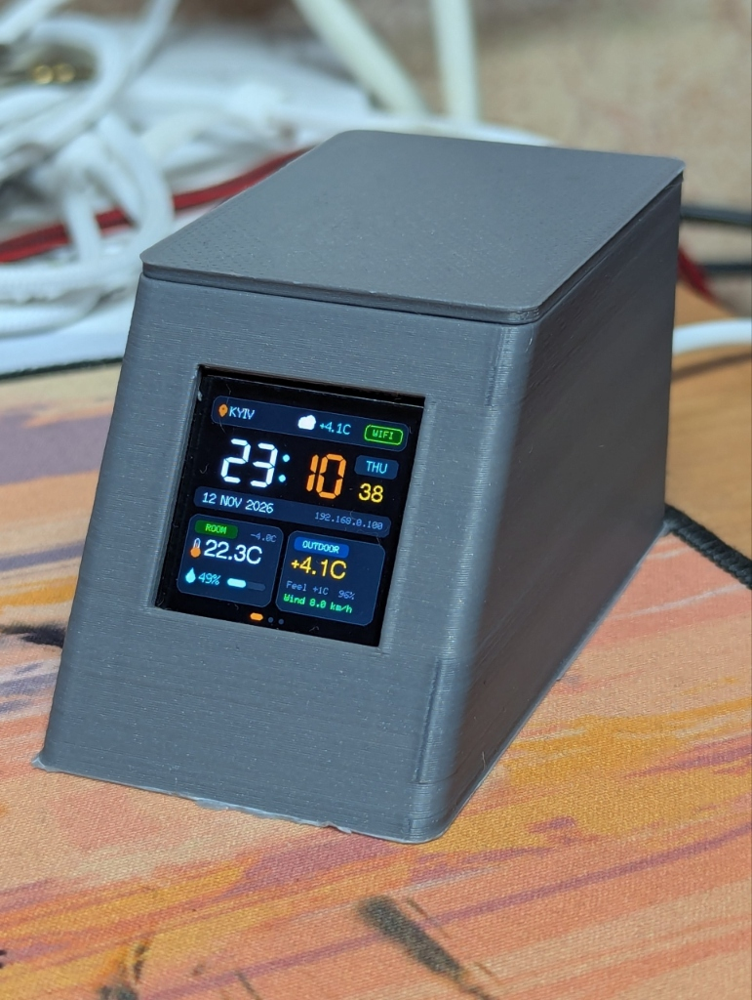

# ESP32 MeteoCube — Desk Clock, Weather & Indoor Climate Station

A compact, 3D-printed ESP32 desk cube inspired by GeekMagic SmallTV, built around a 1.3" 240×240 IPS `ST7789` display and an `SHT30` I2C temperature/humidity sensor. Designed for 24/7 desktop operation with live [Open-Meteo](https://open-meteo.com/) weather, zero-flicker sprite rendering, dynamic self-heating compensation, and Wi-Fi Over-The-Air (`ArduinoOTA`) firmware updates.



---

## Features

- **3 Auto-Cycling UI Screens** (every 8 s, flicker-free):
  1. **Dashboard** — NTP-synchronized two-tone clock (`HH:MM:SS`), weekday/date/IP bar, plus live indoor (`SHT30`) and outdoor summary cards.
  2. **Weather Detail** — Custom vector weather icons, current & apparent ("feels like") temperature, daily min/max, and progress bars for humidity, wind speed, and atmospheric pressure (`mmHg`) via Open-Meteo (no API key required).
  3. **Indoor Climate** — Room temperature and relative humidity with comfort badges (`COOL / COMFORT / WARM`, `DRY / OPTIMAL / HUMID`), raw vs. compensated readings, and `SHT30` internal heater status.

---

## Engineering Challenges & Solutions

Building a sealed desktop gadget instead of leaving wires on a breadboard exposed several hardware and firmware constraints that drove the architecture:

### 1. Flashing Without Opening the Case (`ArduinoOTA` + `min_spiffs.csv`)
* **Problem:** Once the ESP32 and display were mounted inside the 3D-printed enclosure, pulling the board out and holding the `BOOT` button for every USB firmware tweak was inconvenient. Adding `ArduinoOTA` on top of `WiFi`, `HTTPClient`, `ArduinoJson`, and `TFT_eSPI` pushed the binary to `1,393,959 bytes` (`106.4%`), overflowing ESP32's `default.csv` OTA app slot (`1,310,720 bytes` / `1.25 MB`).
* **Solution:**
  * Switched to `board_build.partitions = min_spiffs.csv` (`~1.9 MB` per OTA app slot) and removed unused smooth-font/`SPIFFS` build flags in [platformio.ini](platformio.ini).
  * Integrated `ArduinoOTA` with a live on-screen `0–100%` progress bar so firmware updates upload over Wi-Fi directly to the sealed cube (`upload_protocol = espota`).

### 2. Driving a CS-less ST7789 IPS Module ("Backlight Only" Issue)
* **Problem:** Many 7-pin 1.3" `ST7789` breakouts omit the `CS` (Chip Select) pin. Under standard `SPI_MODE0` or high jumper-wire clocks (`27 MHz`), the controller misses clock synchronization after reset and displays only a lit black backlight.
* **Solution:**
  * Configured `TFT_eSPI` strictly through `platformio.ini` `build_flags` (`-DTFT_CS=-1`, `-DTFT_SPI_MODE=SPI_MODE3`, `-DSPI_FREQUENCY=10000000`) with zero library source edits (`User_Setup.h` untouched).
  * Forced `SCK` `HIGH` before pulsing the hardware `RES` pin (`GPIO4`) in `setup()` so the display latches `SPI_MODE3` idle polarity reliably on every cold boot.

### 3. Zero-Flicker Rendering Within ESP32 DRAM Limits (`115 KB → 41 KB`)
* **Problem:** Calling `tft.fillScreen()` on tab switches and 10 s sensor updates caused noticeable black screen flashes. On an ESP32 without PSRAM, allocating a full `240×240×16-bit` off-screen framebuffer (`115.2 KB` contiguous DRAM) causes allocation failure or starves `WiFi.begin()`.
* **Solution:**
  * Eliminated all `fillScreen()` calls inside the main loop.
  * Partitioned every screen into four horizontal bands (`228×30`, `228×86`, `228×90`, `228×12`) rendered off-screen into a single reusable `228×90` 16-bit `TFT_eSprite` (`~41 KB` RAM) and pushed directly over previous pixels via `pushSprite()`.

### 4. Enclosure Self-Heating Drift (`+1 °C → +4 °C`) & SHT30 Heater Guard
* **Problem:** Inside a compact enclosure next to an active ESP32 Wi-Fi radio, internal PCB heat warms the `SHT30` sensor gradually—from `~+1.0 °C` above ambient on cold start to `~+4.0 °C` at steady state—which also artificially lowers relative humidity (`RH`). Additionally, an accidentally enabled `SHT30` internal heater bit would permanently skew readings.
* **Solution:**
  * Verified and force-disabled `SHT30` status register bit 13 (`0xF32D` read / `0x3066` heater-off command) with CRC-8 (`0x31`) checksum verification on all sensor frames.
  * Modeled enclosure warmup with an exponential thermal offset curve (`τ = 10 min`) persisted in `RTC_NOINIT_ATTR` memory so OTA reboots keep tracking accumulated heat rather than resetting to cold-start offset.
  * Recalculated `RH` from `T_raw` to `T_real` using the Magnus saturation vapor pressure equation.

### 5. 24/7 Reliability & Minimal Hardware Footprint
* **GPIO-Powered Sensor:** Because the `SHT30` draws `< 1.5 mA` (well below ESP32's GPIO limit), `VIN` is wired straight to `GPIO25` and brought high in `setup()` before `Wire.begin()`, simplifying wiring inside the tight enclosure.
* **Zero Flash Wear & Rollover-Safe Timing:** Runtime state stays strictly in RAM/RTC memory with no Flash writes, and all periodic tasks use `uint32_t` subtraction (`now - last >= interval`) to stay safe across the `49.7`-day `millis()` rollover.

---

## Hardware & Wiring

| Component | Notes |
|---|---|
| **MCU** | ESP32-WROOM-32 (DevKit V1, 4 MB Flash) |
| **Display** | 1.3" 240×240 IPS `ST7789` (7-pin module **without CS pin**) |
| **Sensor** | `SHT30` I2C digital temperature & humidity sensor (`0x44` / `0x45`) |
| **Enclosure** | 3D-printed angled desk housing |

### Pinout

#### ST7789 Display (`SPI_MODE3`, CS-less)

| Display Pin | ESP32 GPIO | Notes |
|---|---|---|
| `VCC` | `3.3V` | Regulated 3.3 V |
| `GND` | `GND` | Common ground |
| `SCK` (`SCL`) | `GPIO18` | Pulled `HIGH` before `RES` pulse for `SPI_MODE3` sync |
| `SDA` (`MOSI`) | `GPIO23` | Hardware VSPI MOSI (`10 MHz` SPI clock) |
| `RES` | `GPIO4` | Hardware reset |
| `DC` | `GPIO16` | Data / Command |
| `BLK` | *Not connected* | Backlight always on |

#### SHT30 Sensor (I2C, GPIO-Powered)

| SHT30 Pin | ESP32 GPIO | Notes |
|---|---|---|
| `VIN` | `GPIO25` | Powered directly from `GPIO25` (`< 1.5 mA` load) |
| `GND` | `GND` | Common ground |
| `SDA` | `GPIO21` | I2C data |
| `SCL` | `GPIO22` | I2C clock |

---

## Thermal Compensation Model

When mounted near an active ESP32 inside a closed housing, temperature error rises exponentially toward thermal equilibrium:

$$\Delta T(t) = \Delta T_{\text{start}} + (\Delta T_{\text{warm}} - \Delta T_{\text{start}})\left(1 - e^{-t / \tau}\right)$$

- Warmup uptime $t$ is stored in `RTC_NOINIT_ATTR` (`rtcWarmupSeconds` validated by a magic header), resetting only on true power-on (`ESP_RST_POWERON`) and surviving OTA reboots.
- Relative humidity is corrected from the raw sensor reading $(T_{\text{raw}}, RH_{\text{raw}})$ to the compensated temperature $T_{\text{real}}$ via saturation vapor pressure:

$$RH_{\text{real}} = RH_{\text{raw}} \cdot \frac{e_s(T_{\text{raw}})}{e_s(T_{\text{real}})}, \quad e_s(T) = 6.112 \cdot \exp\left(\frac{17.62 \cdot T}{243.12 + T}\right)$$

All coefficients (`SHT30_OFFSET_START`, `SHT30_OFFSET_WARM`, `SHT30_WARMUP_TAU_MIN`) are tunable in [include/config.h](include/config.h).

---

## Project Structure

```text
esp32-meteocube/
├── docs/
│   └── demo.jpg           # Assembled 3D-printed unit photo
├── include/
│   ├── config.h           # City/NTP timezone, pins, thermal curve & UI timings
│   ├── secrets.example.h  # Template for Wi-Fi credentials
│   └── secrets.h          # Local Wi-Fi credentials (gitignored)
├── src/
│   └── main.cpp           # Display driver init, SHT30 I2C, Open-Meteo, OTA & UI
├── platformio.ini         # ESP32 build flags (TFT_eSPI, min_spiffs.csv, OTA)
├── LICENSE                # MIT License
└── README.md
```

---

## Getting Started

### 1. Configure Wi-Fi & Location

1. Copy `include/secrets.example.h` to `include/secrets.h`:
   ```bash
   cp include/secrets.example.h include/secrets.h
   ```
2. Set `WIFI_SSID` and `WIFI_PASSWORD` inside `include/secrets.h`.
3. *(Optional)* Update `CITY_NAME`, `LATITUDE`, `LONGITUDE`, and `TZ_INFO` in [include/config.h](include/config.h).

### 2. First Flash (via USB)

In [platformio.ini](platformio.ini), temporarily comment out `upload_protocol = espota` and `upload_port = ...` for the initial USB upload (needed once to flash the `min_spiffs.csv` partition table and `ArduinoOTA` receiver):

```bash
pio run --target upload
```

### 3. Subsequent Flashes (via Wi-Fi OTA)

Once booted, the cube prints its IP address on the startup splash screen and on the Dashboard screen. Set that IP in [platformio.ini](platformio.ini):

```ini
upload_protocol = espota
upload_port = 192.168.0.100
```

Run `pio run --target upload` (or click **Upload** in VS Code PlatformIO) to update firmware wirelessly without opening the enclosure or pressing `BOOT`.

---

## Tech Stack

- **Platform / Framework**: ESP32 / Arduino (`PlatformIO`)
- **Language**: C / C++
- **Libraries**: `bodmer/TFT_eSPI@^2.5.43`, `bblanchon/ArduinoJson@^7.0.0`, `ArduinoOTA`, `HTTPClient`, `Wire`
- **External Services**: NTP (`pool.ntp.org`), Open-Meteo Forecast API

---

## License

This project is licensed under the [MIT License](LICENSE).
